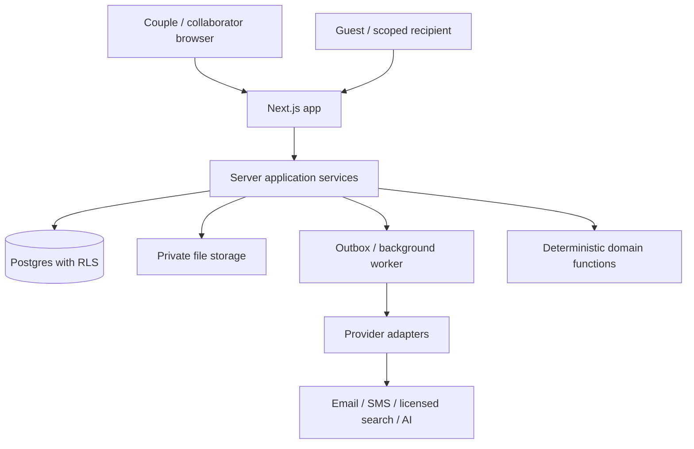

# Architecture

## Proposed baseline (ADR-001)

Modular monolith, web-first PWA. Next.js App Router + React + strict TypeScript; Tailwind CSS + accessible component primitives; PostgreSQL via Supabase (Auth, Storage, optional Realtime). Use SQL migrations and generated database types; use a server-only data-access layer. No ORM required initially. Zod runtime validation; React Hook Form or simple controlled forms. Vitest, Playwright, axe. pnpm with lockfile. PDF server-side renderer (evaluate React PDF for simple reports), CSV with safe escaping. Later: Konva/Fabric for R3 precision canvas, dnd-kit for accessible reorder, charts via Recharts or simpler CSS/SVG, AI/provider adapters. Confirm supported versions and hosting runtime before installing; record actual selections in ADRs. Do not assume any existing code or credentials.

## Context



Front end renders server-first where practical; client components for interactive editors, forms, drag/drop and live filters. RSC/SSR and route handlers can call the same application services. Avoid internal HTTP calls from server components. Use authenticated route handlers for documented mutations/external clients; never duplicate business invariants between UI actions and APIs. RLS defense in depth plus server service authorization. Domain functions pure and independently testable. Use database RPC transactions for multi-table critical mutations if using Supabase JS; never rely on sequential independent API requests for atomicity.

## Repository structure (target)

```text
src/
  app/                  # public, auth, workspace, guest routes; api/v1 routes
  components/           # design primitives, app shell, shared presentation
  features/
    wedding/ discovery/ vendors/ comparisons/ budget/ guests/
    seating/ planning/ design/ website/ documents/ packages/ collaboration/
    assistant/ operations/
  domain/               # pure domain types and rules per module
  server/
    auth/ policies/ services/ repositories/ db/ storage/
    integrations/ jobs/ observability/
  lib/                  # shared formatting, validation, env schemas
  styles/               # semantic CSS tokens, global styles
supabase/
  migrations/ seed.sql
public/                 # licensed or original public assets only
 tests/                 # unit/integration/e2e/fixtures (no real PII)
docs/ prompts/
```

Whitespace before `tests/` is illustrative, directory belongs at root. Prefer features with local UI/query hooks; shared primitives only after reuse. Server-only imports enforced; no service-role credential in client bundles. `domain` cannot import framework, DB SDK or AI SDK. Data access centralized, pagination and workspace scoping required. App code owns transaction orchestration; DB owns constraints and locking. Public views return allowlisted DTOs rather than full domain entities.

## State and consistency

Server database is canonical. URL search params for filters/sort; client state for form/editor drafts; no global client store by default. Use router refresh or explicit cache invalidation following mutations; avoid public caching of authenticated pages. Use optimistic updates only for reversible low-risk changes; revert on failure. `version` integer for concurrency; expected version checked atomically. Every critical transaction increments workspace revision once, creates audit entries and relevant outbox records. Derived metrics are deterministic queries/functions, not independent editable totals. Use outbox at-least-once delivery; idempotent consumers keyed by event ID, provider operation ID; retry with backoff/dead-letter review. Worker infrastructure may be platform scheduled/queue backed; if not provisioned, keep tasks manual and statuses honest.

## Module boundaries

| Module | Owns | Cross-module interaction |
|---|---|---|
| Wedding/auth | settings, roles, events | authorizes all reads/writes |
| Discovery/vendors | candidates, proposals, booking stages | booking creates commitment via service |
| Budget | estimates, commitments, payments, contributions | calculates forecast using event assumptions |
| Guests | households, invitations, RSVPs | seating queue, meal summaries, quote estimates |
| Seating | layouts/tables/assignments | guest/event capacity and attendance constraints |
| Planning | tasks, event timeline/dependencies | contract due dates and event date impact |
| Documents | metadata, authorized storage, extraction jobs | source evidence for proposals/terms |
| Website | sanitized drafts/published projections | event info via explicit publish/update policy |
| Packages | scoped snapshots, artifacts, grants | read authorized projections across modules |
| AI | structured proposals and evaluations | no arbitrary DB writes; normal service commands after review |

## Data integrity and deployment design

Store monetary integer minor units, UTC instants plus IANA timezone semantics, date-only fields as DATE. Enforce workspace ownership through composite foreign keys; use transactions, unique keys and version predicates. Storage private by default, signed URL TTL and access check; public assets separate from private uploads. Environments isolated; migrations applied via automation with rollback/forward fixes. Preview deployment uses synthetic data. Web app can run without configured third parties; no fictional success. Auth and data must never fall back to demo when a production backend is unavailable.

## Architecture evolution

Start with a single app + managed DB/store. Introduce background worker when async delivery/extraction/export requires it; separate search backend only if measured demand. Keep provider adapters replaceable. PWA manifest and app shell in R1; offline wedding packets in R3; do not cache private pages indiscriminately. Native apps only after user validation. Evaluate runtime support for PDF binaries, webhooks, queues, and upload sizes before deployment.
